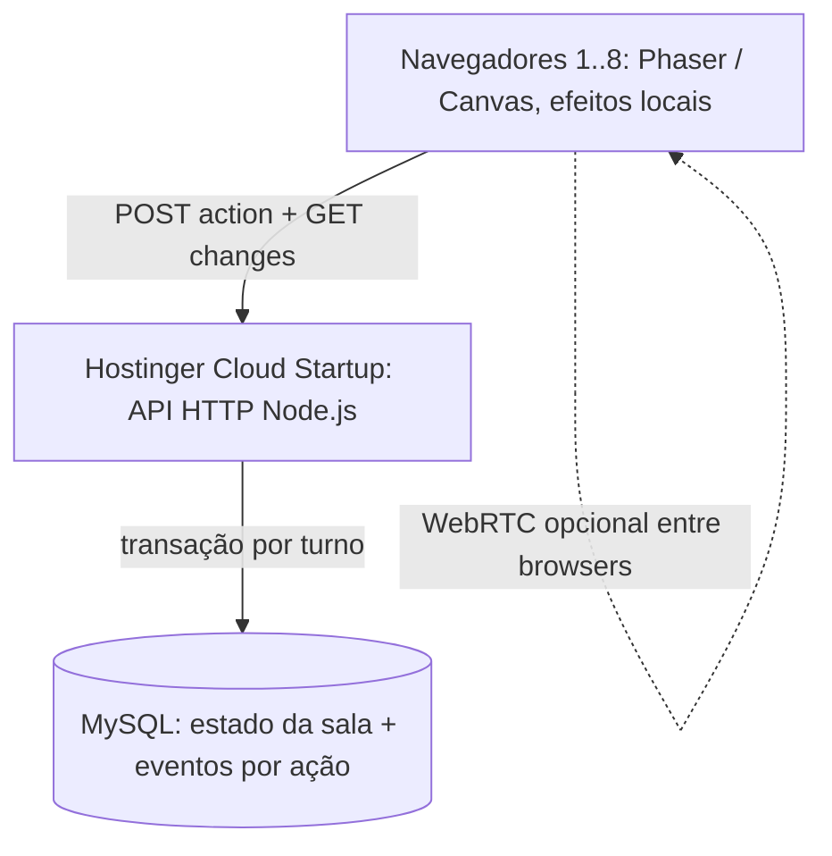

> **Histórico importado em 19/11/2026:** material do MEM-GPT-VIOLI. Para decisões atuais de laboratórios e estados de implementação, consulte `docs/LABORATORIOS.md` e `docs/STATUS_IMPLANTACAO.md`. Declarações antigas de que o repo não existe ou não tem permissão são anteriores à conexão da conta proprietária.

# Hover Shot — arquitetura recomendada: 8 jogadores, uma transição por turno

**Status:** PROPOSTA, não testada no plano. **Documento canônico de regras:** [MODELO_DE_TURNOS.md](MODELO_DE_TURNOS.md).

## 1. Componentes

Todos os jogadores são **observadores do estado oficial**, mas apenas aquele com o turno possui permissão para avançar o jogo. Até 8 clientes em uma sala não significa 8 game loops de servidor. O navegador mantém seu próprio loop de desenho, que não depende de atualização de rede.

### Regra modular de mobiles

**Aduka é requisito obrigatório, não exclusividade.** O frontend e o motor terão um registro `mobile_id -> definição` com características, tipo de projétil, efeitos e regras de dano. Não substituir nem eliminar outros veículos, tiros ou modos já funcionais e reutilizáveis da base selecionada. Cada jogador escolhe `mobile_id` na montagem da sala, e a escolha autorizada fica congelada no estado oficial. O motor aplica a definição do mobile selecionado na simulação de cada turno. O primeiro marco é **visualmente jogável** com recursos já prontos, enquanto a inclusão de Aduka é a condição de aceite da versão inicial completa.

### Fluxo de uma jogada
1. Cliente ativo escolhe `shot_type, item_optional, angle, power, move_final_optional`. **Vento é exibido do snapshot oficial, não enviado como comando autoritativo.**
2. `POST /api/rooms/{room_id}/actions` recebe `request_id UUID, expected_version, turn_id` e escolhas, associando identidade do membro.
3. API abre transação e bloqueio da linha de sala; confere rodada, prazo `deadline_at`, jogador, limites físicos, permissões e repetição.
4. Motor de versão fixa calcula o resultado do tiro completo, inclusive um uso de Dual se permitido, dano, Thor, impactos, mudanças do mapa e próxima vez.
5. **Uma atualização** de sala + **um evento compacto** de jogada; resposta inclui `version` e resultado. Comando repetido recebe o resultado já gravado (idempotência).
6. Demais jogadores recebem `events?after_version=N` e animam visualmente a jogada local. Se perderem eventos ou recarregarem, recebem `snapshot` atual.

### Timeouts sem loop contínuo
Gravar `deadline_at` no banco ao iniciar cada turno. GET/POST relevantes executam primeiro uma função de avanço de turno expirado com transação idempotente. O cron pode realizar uma varredura eventual, caso se queira avanço mesmo com todos desconectados, mas **o primeiro MVP não depende de cron para funcionar**. Não gravar contagem regressiva a cada segundo.

### Caminhada e efeitos
- Movimentos visuais de passos, barra de força, mira, partículas, raios e vibração da tela acontecem **somente no cliente**.
- Se mover altera hitbox, o comando guarda apenas deslocamento/posição final aceitos, preferencialmente dentro do turno que culmina no disparo.
- Terreno e HP são sempre parte do estado oficial; em vez de gravar frames de terreno, guardar máscara/heightmap compactado ou delta de cratera.

## 2. Estado persistido enxuto
- **`rooms`**: `id, code, version, status, current_player, deadline_at, engine_version, rules_version, state_blob, expires_at`. `state_blob` contém vento, RNG seed+posição, Thor, mapa, HP e posições dos 8 jogadores.
- **`members`**: `room_id, player_id, seat, team, token_hash, last_seen_at`, índice de sala+assento.
- **`turn_events`**: `room_id, version, turn_id, request_id, actor, action_json, result_json/hash, created_at`, índices únicos `(room_id,version)` e `(room_id,request_id)`.

**Persistência por ação:** uma transação curta com atualização de `rooms` e inserção de `turn_events`, não inserções de centenas de passos. Para recuperar estado rápido, `state_blob` é o snapshot mais recente. Pode-se descartar eventos antigos após encerramento/retensão, se não forem necessários para replay.

## 3. Endpoints mínimos
- `GET /api/health`
- `POST /api/rooms` / `POST /api/rooms/{id}/join` / `POST /api/rooms/{id}/start`
- `GET /api/rooms/{id}/state` — recuperação/snapshot.
- `POST /api/rooms/{id}/actions` — avança 1 versão (ação ou timeout).
- `GET /api/rooms/{id}/events?after_version=n` — delta; se nenhum novo evento, resposta vazia/304.
- `POST /api/rooms/{id}/signal` e `GET .../signals` — somente se testarmos P2P browser-host.

## 4. Determinismo e consistência
- Usar **uma engine compartilhada TS** no navegador e Node, seed fixa, timestep fixo e parâmetros quantizados; testar onde operações de ponto flutuante podem divergir. Considerar fixed-point nos cálculos críticos.
- Guardar `engine_version/rules_version` por sala; não atualizar regras de uma sala no meio da partida durante deploy.
- Servidor autoridade de resultado e valida estado; cliente reproduz traçado/raios a partir de evento de resultado e renderiza animações independentes.
- Limitar duas ações simultâneas pelo lock e pela versão; UUID de ação para retries idempotentes; tempo do servidor para timeout.
- Sessão privada por código e token de membro, controle de origem, limites de tamanho e frequência, sem armazenar tokens em claro.

## 5. Transporte e UX
**Baseline:** GET com `after_version`, polling adaptativo em 2–5 s (hipótese inicial, ajustar em teste). POST FIRE retorna logo ao jogador; outros observam o turno no próximo GET. Pausar/reduzir polling em abas ocultas, mas checar ao voltar. Backoff em erros e fim de partida sem consultas. Assets estáticos com cache; API `no-store`.

**Adaptações a testar:**
- SSE ou long-poll para notificação rápida de nova versão.
- HTTP relay com host navegador executando a simulação e servidor guardando eventos/snapshots.
- WebRTC DataChannel entre host e outros, com a sinalização pelo próprio HTTP da Hostinger. Se P2P não conectar, usar sempre o transporte HTTP que já mantém o estado.

## 6. Eficiência e limpeza
Exemplo **estimativo**: 8 jogadores consultando a cada 4 segundos -> 2 GET/s/sala; para 20 salas seriam 40 GET/s, ainda precisa **medir** CPU/DB/limites do plano e impacto nos demais sites. O tráfego de cada tiro é pequeno; a maior parte dos acessos é verificar versão. Responder com índice de versão e payload vazio quando não houver mudança.

TTL de salas inativas, remoção segura de eventos após partida, sinalização P2P com TTL de minutos, logs sanitizados e retenção curta. Limpeza em lotes pequenos por cron finito ou oportunidade de acesso, sem criar tarefas permanentes. Código/documentação no GitHub; snapshots e dados operacionais permanecem em MySQL isolado.

## 7. Prioridade de implantação
1. Rodar localmente física e testes.
2. Verificar API HTTP Node.js e banco isolados no Cloud Startup.
3. Provar consistência de 1x1, 2x2 e 4x4.
4. Testar novas formas de notificação/P2P apenas se melhorarem desempenho ou experiência.

**O estado da partida deve ser único, compacto, recuperável e determinístico; a animação não é dado persistente. O catálogo de mobiles é extensível e Aduka deve estar presente.**
